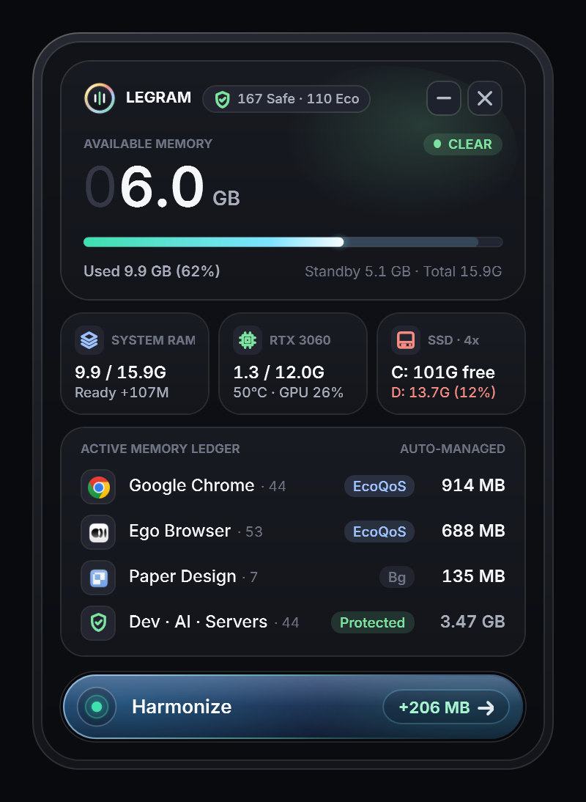
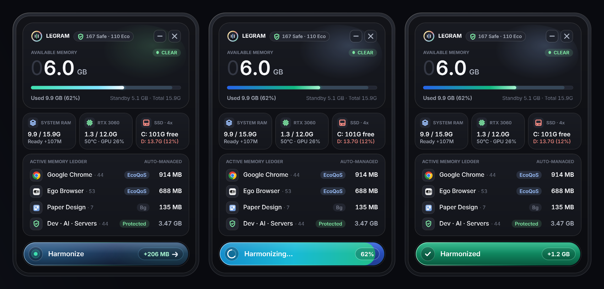
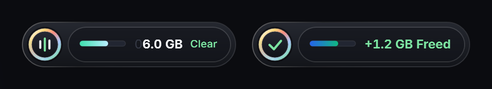

<div align="center">
  
  <h1>Legram</h1>
  <p><strong>Precision Windows 10/11 RAM, GPU VRAM &amp; SSD Harmonizer</strong><br/>
  Zero dependencies &middot; Single ~209 KB native x64 binary &middot; Zero foreground stutter</p>

  <p>
    <a href="https://github.com/Ssesuatu/legram/releases/latest"></a>
    
    
    <a href="LICENSE"></a>
  </p>
</div>

---

**Legram** is an ultra-lightweight Windows memory, WDDM GPU VRAM, and local SSD harmonizer engineered for developers, creators, gamers, and local AI workflows.

Unlike traditional "RAM cleaners" that indiscriminately strip active working sets or nuke the entire Windows Standby List (causing severe disk-read stutter), Legram uses **selective low-priority NT kernel calls**, **process-tree immunity**, and **Windows 11 EcoQoS + background I/O throttling** to reclaim wasted memory while keeping your active apps, audio streams, compilers, and local servers completely untouched.

<p align="center">
  
  &nbsp;&nbsp;
  
</p>

<p align="center">
  
  &nbsp;&nbsp;
  
</p>

---

## Install (Portable)

1. Download **`Legram-2.5.0-win-x64.zip`** from [Releases](https://github.com/Ssesuatu/legram/releases) and optionally verify it against `Legram-2.5.0-win-x64.zip.sha256`.
2. Extract it to any writable folder, for example `%LOCALAPPDATA%\Programs\Legram` (keep the `fonts` folder next to `Legram.exe`).
3. Run **`Legram.exe`**.
   - Double-click the header bar to fold into **Mini Capsule Mode**, or press **`Ctrl + Alt + L`** from anywhere to trigger a 1-Click Unified Harmony sweep.
   - Right-click anywhere on the window (or the numeric system tray icon) to toggle **Launch at Windows Sign-In** (`--background`) or enable **0-UAC Kernel Standby Purge**.

> **Note:** Releases are not code-signed yet, so Windows SmartScreen may ask you to confirm on first launch (**More info &rarr; Run anyway**).

---

## Key Capabilities

### 1. Zero-Stutter Kernel Reclamation (`NtSetSystemInformation`)
- **Physical Page Deduplication (`MemoryCombineInformationEx`, Class `130`):** Merges identical read-only pages across processes without touching active allocations.
- **Low-Priority Standby Purge (`MemoryPurgeLowPriorityStandbyList`, Cmd `5`):** Frees cold cached pages (`Priority 0–4`) back to the Free Page List while preserving hot `Priority 5–7` file cache pages so desktop responsiveness never stutters.
- **Registry & System Cache Compaction (`Class 155` + `SetSystemFileCacheSize`):** Flushes slack registry hive buffers and bloated NTFS metadata caches.
- **Optional 0-UAC Scheduled Helper:** One-time UAC setup registers `Legram_PurgeHelper` (`HIGHEST` privilege) so subsequent kernel standby purges run silently in `<150 ms` with zero UAC prompts.

### 2. ISLC-Style Standby Guard & Commit Exhaustion Shield
- **Anti-Microstutter Trigger (ISLC Logic):** Automatically purges low-priority standby pages when `Available RAM < 1.5 GB` while `Standby Cache > 4.0 GB` — fixing frame-time spikes in games and heavy creative workloads before Windows scrambles for free frames.
- **Virtual Commit Charge Protection:** Monitors total Windows Commit Charge (`Pagefile + Physical RAM`). Triggers proactive reclamation at `>= 85%` commit usage to prevent sudden `"Out of Memory"` crashes in browsers, IDEs, and AI runtimes even when physical RAM appears available.

### 3. Windows 11 EcoQoS + Background I/O Saver
- Applies **`PROCESS_POWER_THROTTLING_EXECUTION_SPEED`** (Efficiency Cores / EcoQoS) and **`IoPriorityHintVeryLow`** (`NtSetInformationProcess` Class `33`) to known background bloat, updaters, indexers, and idle helper processes.
- Dynamically **restores normal QoS and I/O priority** the instant any window gains focus or enters the protected immunity graph.

### 4. GPU VRAM, DWM & Orphan AI / WSL Reclamation
- **WDDM Per-Process VRAM Telemetry:** Tracks dedicated + shared GPU memory via native PDH `GPU Process Memory` counters without waking discrete GPUs via `nvidia-smi`.
- **DWM Composition Leak Guard:** Gently trims `dwm.exe` only when Desktop Window Manager working set exceeds `450 MB` (common after multi-monitor sleep/wake or alt-tab cycles).
- **Orphan AI & Idle WSL2 Cleanup:** Politely unloads idle Ollama models (`POST /api/generate` with `keep_alive: 0` when idle `> 10 min`), reclaims orphaned headless CLI workers whose parent terminal exited, and shrinks idle `vmmemWSL` allocations.

### 5. Safe Physical SSD Sweep
- Cleans stale files (`> 24 hours` untouched) across `%TEMP%`, browser HTTP/GPU shader caches, Windows Error Reporting (`WER`), crash dumps, Squirrel/Updater leftovers, and empties the Recycle Bin — skipping any locked file or active build artifact.

---

## Automatic Process Immunity

Legram builds a live parent-child process tree and **never trims or throttles**:
- **Foreground & Input-Active Windows** (current focused app + active UI threads)
- **Real-Time Audio & Media Pipelines** (`audiodg`, DAWs, OBS, Discord voice, Spotify, ASIO/WASAPI hosts)
- **Developer Toolchains & Local Servers** (VS Code, Visual Studio, JetBrains IDEs, `node`, `python`, `rust-analyzer`, `gopls`, active compilers, Docker, active WSL terminals, and processes listening on local dev ports)
- **Windows Core & Security Subsystems** (`System`, `csrss`, `lsass`, `smss`, `services`, `wininit`)

---

## Build from Source (Zero Dependencies)

Legram compiles directly with the `.NET Framework 4.x` C# compiler (`csc.exe`) pre-installed on every Windows 10 and Windows 11 machine. **No Visual Studio, .NET SDK, or NuGet packages required.**

```powershell
git clone https://github.com/Ssesuatu/legram.git
cd legram

# Compile bin\Legram.exe (~209 KB) and stage portable assets
powershell -NoProfile -ExecutionPolicy Bypass -File .\build\build.ps1

# Launch Legram
.\bin\Legram.exe
```

### Optional: Enable 0-UAC Kernel Standby Purge

Click **Right-Click &rarr; Kernel Standby Purge (`Enable`)** inside the app, or run once:

```powershell
powershell -NoProfile -ExecutionPolicy Bypass -File .\setup-task.ps1
```

---

## Command-Line Interface

| Argument | Description |
| :--- | :--- |
| *(none)* | Launches the Legram Monolith UI (or focuses the existing instance) |
| `--background` | Starts silently in the Windows System Tray (used for Windows Sign-In startup) |
| `--open` | Opens and focuses the running Legram window |
| `--purge` | Signals the running Legram instance to execute a 1-Click Unified Harmony sweep |
| `--purge-helper` | Runs a headless low-priority kernel combine + standby purge and exits (`0` on success) |
| `--quit` | Gracefully exits the running Legram instance |
| `--selftest [dir]` | Runs automated architecture, immunity, and UI verification and exports 2x HiDPI PNG proofs |

---

## Privacy & License

- **100% Local & Zero Telemetry:** No internet access or analytics. See [PRIVACY.md](PRIVACY.md).
- Released under the [MIT License](LICENSE). See [THIRD_PARTY_NOTICES.md](THIRD_PARTY_NOTICES.md) for bundled font notices.
