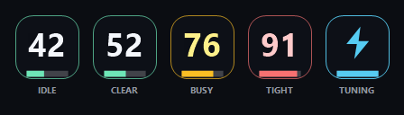

<div align="center">
  
  <h1>Legram</h1>
  <p><strong>Precision Windows 10/11 RAM, GPU VRAM &amp; SSD Harmonizer</strong><br/>
  Zero dependencies &middot; Single ~225 KB native x64 binary &middot; Zero foreground stutter</p>

  <p>
    <a href="https://github.com/Ssesuatu/legram/releases/latest"></a>
    
    
    <a href="LICENSE"></a>
  </p>
</div>

---

**Legram** is an ultra-lightweight Windows memory, WDDM GPU VRAM, and local SSD harmonizer engineered for developers, creators, gamers, and local AI workflows.

Unlike traditional "RAM cleaners" that indiscriminately strip active working sets or nuke the entire Windows Standby List (causing severe disk-read stutter), Legram uses **selective low-priority NT kernel calls**, **hysteresis-latched commit relief**, **process-tree immunity**, and **Windows 11 EcoQoS + background I/O throttling** to reclaim wasted memory while keeping your active apps, audio streams, compilers, and local servers completely untouched.

<p align="center">
  
  &nbsp;&nbsp;
  
</p>

<p align="center">
  
  &nbsp;&nbsp;
  
</p>

---

## Install (Portable)

1. Download **`Legram-2.7.0-win-x64.zip`** from [Releases](https://github.com/Ssesuatu/legram/releases) and optionally verify it against `Legram-2.7.0-win-x64.zip.sha256`.
2. Extract it to any writable folder, for example `%LOCALAPPDATA%\Programs\Legram` (keep the `fonts` folder next to `Legram.exe`).
3. Run **`Legram.exe`**.
   - Double-click the header bar to fold into **Mini Capsule Mode**, press **`Ctrl + Alt + L`** to toggle the Legram window, or press **`Ctrl + Alt + H`** from anywhere to trigger a **Silent 1-Click Unified Harmony** sweep without leaving your active app.
   - Right-click anywhere on the window (or the numeric system tray icon) to toggle **Launch at Windows Sign-In** (`--background`), **Game Mode Auto-Pause**, **Virtual Desktop Auto-Sleep**, or enable **0-UAC Kernel Standby Purge**.

> **Note:** Releases are not code-signed yet, so Windows SmartScreen may ask you to confirm on first launch (**More info &rarr; Run anyway**).

---

## Key Capabilities

### 1. Zero-Stutter Kernel Reclamation (`NtSetSystemInformation`)
- **Physical Page Deduplication (`MemoryCombineInformationEx`, Class `130`):** Merges identical read-only pages across processes without touching active allocations.
- **Low-Priority Standby Purge (`MemoryPurgeLowPriorityStandbyList`, Cmd `5`):** Frees cold cached pages (`Priority 0`) back to the Free Page List while preserving warm file cache pages so desktop responsiveness never stutters.
- **Registry & System Cache Compaction (`Class 155` + `SetSystemFileCacheSize`):** Flushes slack registry hive buffers and bloated NTFS metadata caches, while surfacing live **Kernel Non-Paged / Paged Pool** and **Modified Page List** telemetry.
- **Optional 0-UAC Scheduled Helper (AC & Laptop Battery Ready):** One-time UAC setup registers `Legram_PurgeHelper` (`HighestAvailable`, `DisallowStartIfOnBatteries=false`) so subsequent kernel standby purges run silently in `<150 ms` on desktops and unplugged laptops alike.

### 2. ISLC-Style Standby Guard & Hysteresis Commit Shield
- **Anti-Microstutter Trigger (ISLC Dual-Threshold):** Automatically purges standby pages when `Free + Zeroed RAM < 1.0 GB` while `Standby Cache >= 4.0 GB` — preventing frame-time spikes in games and heavy creative workloads before Windows scrambles for zeroed frames.
- **Thrash-Free Virtual Commit Protection:** Separates *Physical RAM pressure* from *Virtual Commit Charge* (`RAM + Pagefile`). When Commit reaches `>= 90%` while physical RAM is plentiful, Legram skips futile working-set stripping and strictly executes commit-reducing relief (idle AI VRAM/model eviction, orphan worker cleanup, non-destructive WSL2 cache drop) with an `<= 84%` hysteresis latch so background apps never suffer repetitive page-fault loops.

### 3. Windows 11 EcoQoS, Background I/O Saver & Virtual Desktop Sleep
- Applies **`PROCESS_POWER_THROTTLING_EXECUTION_SPEED`** (Efficiency Cores / EcoQoS) and **`IoPriorityLow`** (`NtSetInformationProcess` Class `33`) to background multi-process browsers and inactive Virtual Desktop workspaces while keeping the entire foreground app tree and high-priority games (`HIGH_PRIORITY_CLASS`) 100% untouched.
- Includes interactive `[1] [2] [+]` Virtual Desktop switcher pills with automatic window follow and 1-click user process immunity shields (propagated across child processes).

### 4. Multi-Vendor GPU VRAM, DWM & Non-Destructive WSL2 Reclamation
- **NVIDIA NVML + AMD / Intel WDDM Adapter Telemetry:** Reads direct NVML metrics on NVIDIA GPUs and resolves exact hardware adapter names & `64-bit` dedicated VRAM capacity (`HardwareInformation.qwMemorySize`) via `EnumDisplayDevicesW` + WDDM Display Class Registry on AMD Radeon, Intel Arc, and hybrid GPUs. Tracks per-category VRAM (*Compositor/DWM*, *Browser*, *AI/LLM*, *Apps/Games*) and auto-recovers handles after S3 Sleep or GPU driver resets (`Win+Ctrl+Shift+B`).
- **DWM Composition Leak Guard:** Gently trims `dwm.exe` working set when Desktop Window Manager bloats past `450 MB`.
- **Multi-Engine AI Unloader & Non-Destructive WSL2 Reclaim:** Politely unloads idle **Ollama** (`:11434`), **LM Studio** (`:1234`), and **ComfyUI** (`:8188/free`) models when GPU utilization is idle, reaps orphaned headless runners, and drops **WSL2 Linux page caches** (`drop_caches`) without shutting down active Linux terminals or Docker containers.

### 5. Safe Physical SSD Sweep
- Cleans stale files across `%TEMP%` (`> 24h`), Windows Error Reporting (`WER` `> 7d`), crash dumps (`> 2h`), stale DirectX shader & Squirrel updater archives (`> 14–30d`), orphaned Photoshop scratch files, and empties the Recycle Bin — skipping cloud/WinFsp/Dokan/ProjFS virtual drives and locked files automatically.

---

## Automatic Process Immunity

Legram builds a live parent-child process tree and **never trims or throttles**:
- **Foreground & Input-Active Windows** (current focused app + active UI/helper threads, plus passive D3D fullscreen Game Shield)
- **Real-Time Audio & Media Pipelines** (`audiodg`, DAWs, OBS, Discord voice, Spotify, ASIO/WASAPI active endpoints)
- **Developer Toolchains, Virtual Mounts & Local Servers** (VS Code, Visual Studio, Cursor, Zed, JetBrains IDEs, compilers, LSPs, Docker, WinFsp/Dokan/rclone virtual mounts, and processes listening on local TCP ports)
- **Windows Core, Network VPN & Anti-Cheat Subsystems** (`System`, `csrss`, `lsass`, `dwm`, WireGuard/Tailscale/Cloudflare WARP, Vanguard/EAC/BattlEye)

---

## Build from Source (Zero Dependencies)

Legram compiles directly with the `.NET Framework 4.x` C# compiler (`csc.exe`) pre-installed on every Windows 10 and Windows 11 machine. **No Visual Studio, .NET SDK, or NuGet packages required.**

```powershell
git clone https://github.com/Ssesuatu/legram.git
cd legram

# Compile bin\Legram.exe (~225 KB) and stage portable assets
powershell -NoProfile -ExecutionPolicy Bypass -File .\build\build.ps1

# Launch Legram
.\bin\Legram.exe
```

### Optional: Enable 0-UAC Kernel Standby Purge

Click **Right-Click &rarr; Kernel Standby Purge (`Enable`)** inside the app, or run once:

```powershell
powershell -NoProfile -ExecutionPolicy Bypass -File .\setup-task.ps1
```

---

## Command-Line Interface

| Argument | Description |
| :--- | :--- |
| *(none)* | Launches the Legram Monolith UI (or focuses the existing instance) |
| `--background` | Starts silently in the Windows System Tray (used for Windows Sign-In startup) |
| `--open` | Opens and focuses the running Legram window |
| `--purge` | Signals the running Legram instance to execute a 1-Click Unified Harmony sweep |
| `--purge-helper` | Runs a headless low-priority kernel combine + standby purge and exits (`0` on success) |
| `--quit` | Gracefully exits the running Legram instance |
| `--selftest [dir]` | Runs automated architecture, immunity, and UI verification and exports 2x HiDPI PNG proofs |

---

## Privacy & License

- **100% Local & Zero Telemetry:** No internet access or analytics. See [PRIVACY.md](PRIVACY.md).
- Released under the [MIT License](LICENSE). See [THIRD_PARTY_NOTICES.md](THIRD_PARTY_NOTICES.md) for bundled font notices.
